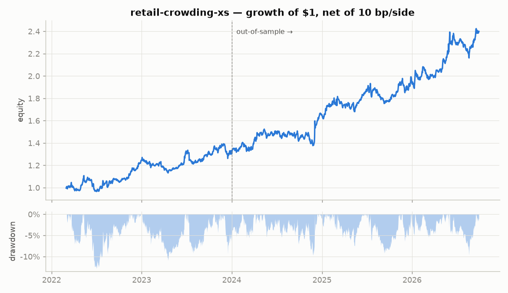
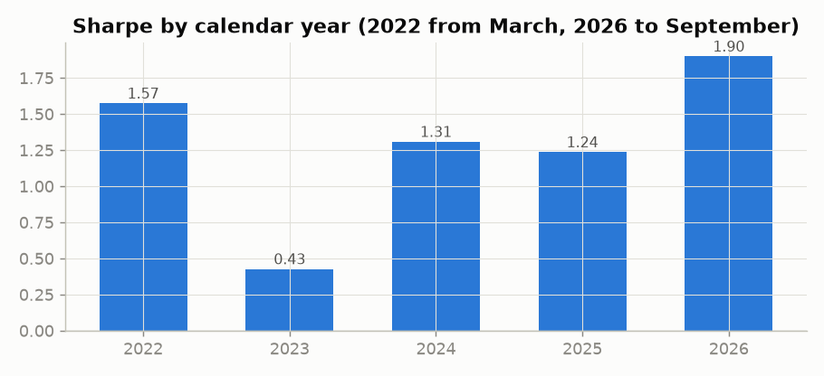

# retail-crowding-xs — deployable spec

**Status:** Working (moderate). Report: `past_research/crypto-perps/retail-crowding-xs/2026-09-30_retail_crowding_xs.md`.
**Signal code:** `code/crypto-perps/retail-crowding-xs/strategy.py::target_weights(close, volume, ls_ratio)`, all
parameters defaulted to this spec.

## What it trades

| | |
|---|---|
| Instruments | spot, yfinance `XXX-USD` daily closes of the 64 coins in `code/crypto-perps/shared/funding_panel.py::PERP_OF`, BTC-USD included (same tickers and quote source as `live/crypto-alts/alt-sleeve-blend`) |
| Book | `sim`, `SimPortfolioBroker(symbols=<the 64 tickers>, quotes="yahoo-daily", allow_short=True, max_gross=1.0)` |
| Direction | long / short, dollar-neutral-ish (net ≈ +0.04), beta-neutral to BTC |
| Leverage | gross ≈ 0.98 on average, **max 1.0** — no leverage beyond 1× gross |
| Rebalance | daily, at the yfinance close of D (00:00 UTC of D+1); weights apply to D+1's return |
| Holding | 7 staggered tranches = mean of the last 7 daily target books (turnover ≈ 31×/yr) |
| Cost assumed | 10 bp per side on traded notional (Sharpe 1.05 at 20 bp, 0.86 at 30 bp) |

## Signal

1. **Input `ls_ratio`**: the Binance USD-M `count_long_short_ratio` of each coin's USDT perp, which
   counts accounts net long divided by accounts net short. Take one value per day D: the last value
   whose **archive stamp is before D 23:00 UTC**.
   - REST (`fapi.binance.com/futures/data/globalLongShortAccountRatio?period=5m`) stamps the same
     value 5 minutes later, so use REST rows stamped ≤ D 23:00.
   - Backfill: `metrics_panel.daily_metrics(syms)["count_long_short_ratio"]` (archive parquet files in
     `data/<SYM>_metrics_5m.parquet`).
   - Live: `metrics_panel.daily_from_frame(metrics_panel.fetch_rest(sym).to_frame())`, where
     `fetch_rest` already subtracts the 5 minutes.
   - REST keeps 30 days. The eligibility rule needs ≥ 60 days of ratio history, so seed from the
     archive files. The archive is published with a 1-day lag.
   - Map ticker to perp with `PERP_OF`, e.g. `SHIB-USD` → `1000SHIBUSDT`. The ratio is unit-free.
2. **Universe**: point-in-time top 20 by trailing-90-day median USD volume (yfinance `Volume`) among
   coins with ≥ 120 closes, median volume ≥ $1M, a ratio on D, and ≥ 60 days of ratio history.
3. **Score**: `−log(ls_ratio)`. Long the 30 % of the universe with the *lowest* ratio (6 names) and
   short the 30 % with the *highest*. Equal weight, 0.5 gross per side.
4. **Beta-neutralise**: rescale the long and short legs so that Σ w·β = 0, with β the EWM-60 beta of
   daily returns to BTC-USD, clipped to [−0.5, 3].
5. **Tranche**: target weight on D = mean of the step-3/4 books of D−6 … D.

## Performance (net of 10 bp/side, daily returns, √365)

| window | Sharpe | CAGR | MaxDD | vol |
|---|---|---|---|---|
| Full 2022-03 → 2026-09 | 1.25 | 21.0 % | −12.8 % | 16.3 % |
| IS 2022-03 → 2023-12 | 0.99 | 16.0 % | −12.8 % | 16.4 % |
| OOS 2024-01 → 2026-09 | 1.43 | 24.5 % | −9.7 % | 16.3 % |

- **Book:** turnover 30.7× per year; average gross 0.975, net +0.04; realised beta to BTC 0.005.
- **By year:** 2022 1.57, 2023 0.43, 2024 1.31, 2025 1.24, 2026 YTD 1.90.
- **Correlation with the live `crypto-alts/alt-sleeve-blend`:** 0.05. A 50/50 equal-risk pair has
  Sharpe 1.96 OOS, against 1.49 for the blend alone.

## Known risks

- **Short history:** 2021-12 onward only. DSR 0.65 at N = 57.
- **Selection:** the selection-free ensemble of the five normalisations earns 0.80 / 0.61 OOS.
- **Static coin tilt:** about 60 % of OOS is a coin preference. The book is persistently long TRX,
  BTC and BCH, and short DOGE, ADA, XRP and SHIB.
- **Concentration:** one TRX day (2024-12-03) was +10 %. Without TRX in the universe: 1.01 full /
  0.61 IS / 1.32 OOS.
- **Short squeezes on retail favourites** are the tail. The worst day was −5.2 % (XRP, 2023-07-13).

