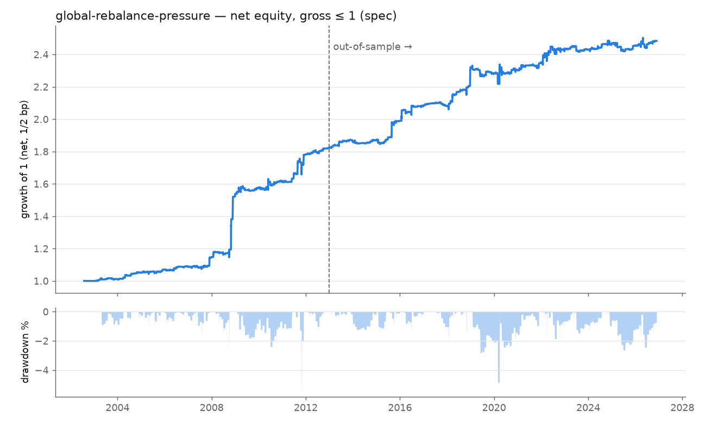
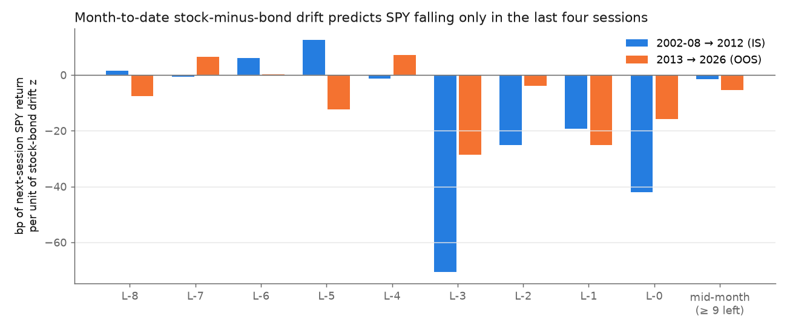

# Alpha: global-rebalance-pressure

**Status:** Working (fading in recent years). Report: `past_research/global-equity-etf/global-rebalance-pressure/`.

| Field | Value |
|---|---|
| Instruments | SPY and EFA in a fixed 0.6 / 0.4 mix |
| Direction | long or short (directional), flat ~81 % of sessions |
| Signal | Z_t = Σ(r_SPY − r_IEF) since the previous month-end close ÷ (252d std × √n); needs SPY, EFA, IEF closes |
| Window | the weight set at close t is live only if session t+1 is one of the **last 4 sessions** of its month (NYSE calendar) |
| Sizing | w_t = −clip(Z_t, −2, 2)/2 × GROSS; SPY 0.6·w, EFA 0.4·w; re-set every close in the window |
| Max leverage | gross 1.0 (GROSS = 1, the validated setting) |
| Rebalance | daily inside the window, flat outside |
| Bars | daily closes, US/Eastern; fills at the signal close |
| Cost assumed | SPY 1 bp/side, EFA 2 bp/side |
| Net Sharpe | 0.84 full (2002-08 → 2026-11) / 1.01 IS / 0.69 OOS (2013+); 2020-26 0.38 |
| CAGR / vol / MaxDD | 3.8 % / 4.6 % / −5.5 % |
| Turnover | 10.8× gross per year; average gross 0.064 |
| Code | `code/global-equity-etf/global-rebalance-pressure/strategy.py` → `target_weights(close)` |

Risks: fading (2020-26 0.38), crisis-concentrated (2008 = +30 %), and a one-session lag makes it 0.18.
Depends on `shared/trading_calendar.py` (NYSE holidays 2026-27; extend yearly).

