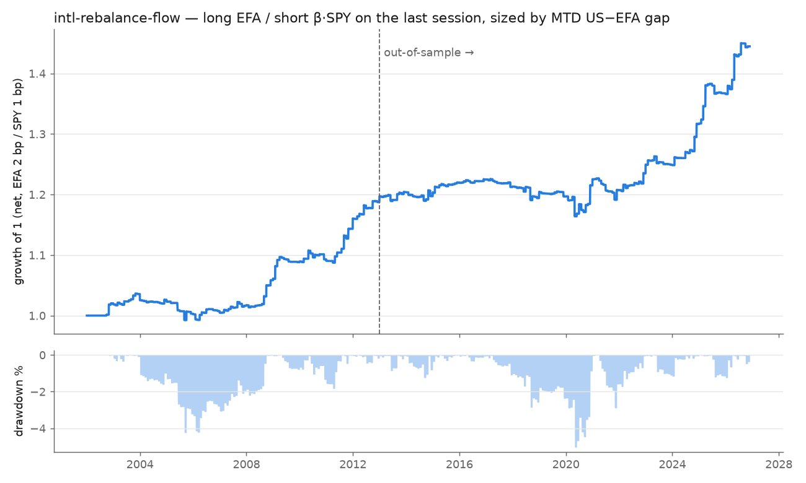
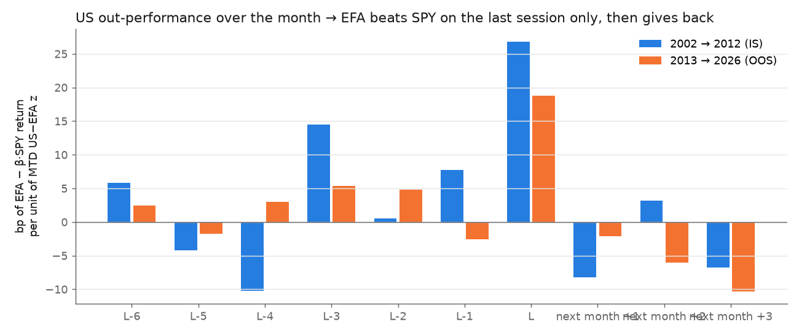

# Alpha: intl-rebalance-flow (sleeve-grade)

**Status:** Working, borderline. Use it as a sleeve, not standalone. See `past_research/global-equity-etf/intl-rebalance-flow/`.

| Field | Value |
|---|---|
| Instruments | EFA (long/short), SPY (hedge, opposite sign) |
| Direction | long/short spread, market-neutral (β-hedged) |
| Signal | Z = month-to-date Σ(r_SPY − r_EFA) through close t ÷ (252d std of EFA − β·SPY × √n) |
| Entry | close of the session **before** the last session of the month (NYSE calendar) |
| Exit | close of the last session of the month (held one session) |
| Sizing | pos = clip(Z, −2, 2)/2 × 2.0; w_EFA = pos, w_SPY = −β_t·pos (252d beta, min 126) |
| Max leverage | gross 4.46 observed (EFA 2.0 + SPY ≈ 2.2·β), one session a month |
| Rebalance | monthly, one session |
| Bars | daily closes, US/Eastern, fills at the signal close |
| Cost assumed | EFA 2 bp/side, SPY 1 bp/side |
| Net Sharpe | 0.69 full (2002-26) / 0.83 IS / 0.60 OOS (2013-26) |
| CAGR / vol / MaxDD | 1.5 % / 2.2 % / −5.0 % |
| Turnover | 33× gross per year; time in market 4.6 % |
| Code | `code/global-equity-etf/intl-rebalance-flow/strategy.py` → `target_weights(close)` |

Risks: a one-session lag turns it to −0.52 (it reverses on the next session), it is flat in 2013-19, and it is
cost-sensitive (0.35 at 2.5× costs). Depends on `shared/trading_calendar.py` NYSE holidays (2026-27;
extend yearly).

