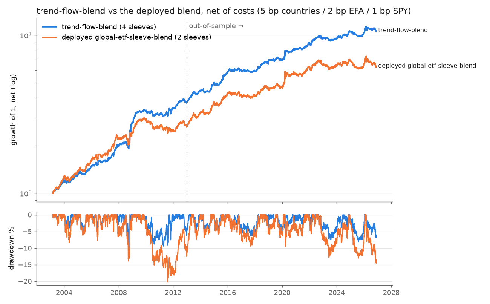

# Alpha: trend-flow-blend (recommended deployment; supersedes global-etf-sleeve-blend)

**Status:** Working. Report: `past_research/global-equity-etf/trend-flow-blend/2026-11-28_trend_flow_blend.md`.

| Field | Value |
|---|---|
| Traded instruments | EWJ EWG EWU EWZ EWY EWA EWC FXI INDA, SPY, EFA |
| Signal-only input | IEF close (stock/bond drift of the rebalance sleeve) |
| Direction | long/short; four sleeves (market-neutral trend, FOMC long basket, directional month-end rebalance, EFA−β·SPY spread) |
| Weights | 0.490·intl-relative-trend + 0.605·fomc-global-beta + 0.861·global-rebalance-pressure + 0.672·intl-rebalance-flow |
| Gross cap | per session, scale the row to 4.0 if Σ\|w\| > 4.0 (never bound 2003-26; max 3.97) |
| Max leverage | gross 4.0 (validated max 3.97; average 1.11; 99th pct 2.32) |
| Rebalance | daily target (trend sleeve changes at month-ends; flow sleeves in the last 4 sessions of the month; FOMC −1/0) |
| Bars / timezone | daily closes, US/Eastern; fills at the close the signal is computed on |
| Costs assumed | country ETFs 5 bp/side, EFA 2 bp/side, SPY 1 bp/side |
| Net Sharpe | **1.25 full (2003-03 → 2026-11) / 1.40 IS / 1.15 OOS (2013+)**; 2020-26 0.89 |
| CAGR / vol / MaxDD | 10.5 % / 8.3 % / −9.5 % |
| Turnover | 42× gross per year |
| Code | `code/global-equity-etf/trend-flow-blend/strategy.py` → `target_weights(close)` (close needs the 11 traded tickers + IEF) |

Deploy **instead of** `global-etf-sleeve-blend`, not alongside it (daily corr 0.86).
Calendars to extend before 2028: `code/global-equity-etf/shared/trading_calendar.py` (NYSE holidays) and
`code/global-equity-etf/fomc-global-beta/fomc_snapshot.csv`.

