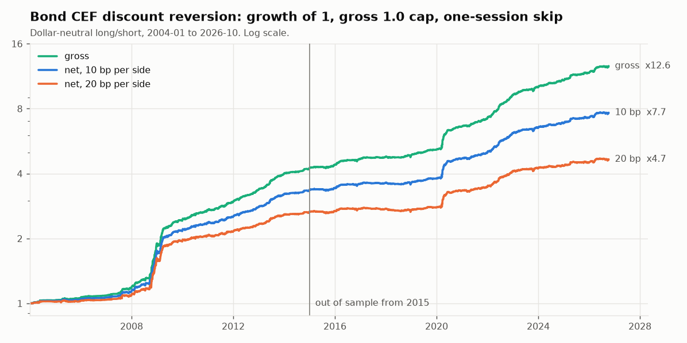
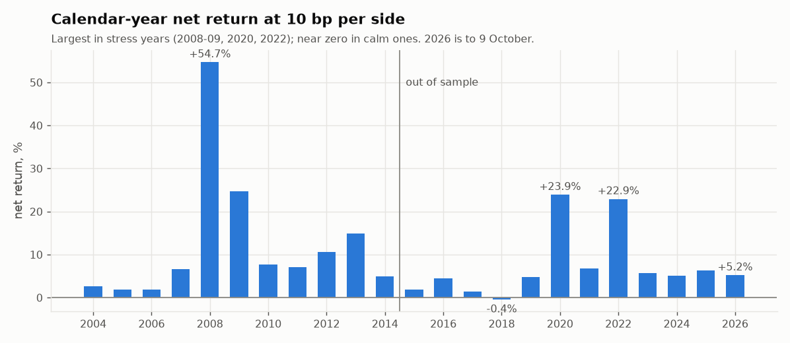
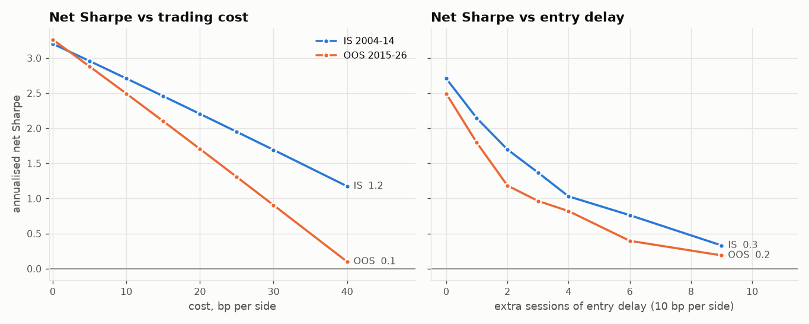
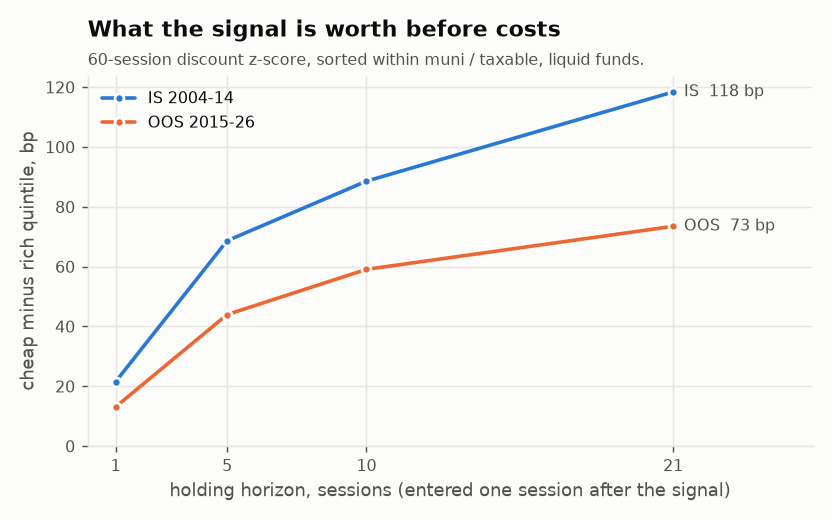

# cef-discount-reversion — alpha spec

**Status:** Working (capacity-limited, cost-sensitive — read "What can break it").
**Asset class:** rates-bonds (US-listed municipal and taxable bond closed-end funds).
**Code:** `code/rates-bonds/cef-discount-reversion/strategy.py :: target_weights()`
**Report:** `past_research/rates-bonds/cef-discount-reversion/2026-10-10_cef_discount_reversion.md`

## Idea in one paragraph

A closed-end fund has no creation/redemption, so its market price is set by order flow
(mostly retail) while its NAV is set by the bond market. Flow pushes the price away from NAV
for days at a time. A fund whose discount is wider than its own 60-session average *and*
wider than its peers' is being sold for non-fundamental reasons; it outperforms over the next
one to three weeks. A fund that has run rich underperforms. The book is long the first kind
and short the second, dollar-neutral.

## Rules

| Item | Value |
|---|---|
| Universe | Bond CEFs listed on CEFConnect (snapshot `cef_universe.csv`, 170 funds: 72 muni, 98 taxable). Preferreds and convertibles excluded. `DHY` excluded (broken dividend history on Yahoo). |
| Eligible on day s | trailing 60-session median dollar volume ≥ $1M, median price ≥ $3, ≥ 250 sessions listed, a daily NAV (not frozen 10 sessions, not a copy of the price), no ×3 price print in 60 sessions. About 70-85 funds in 2015-26. |
| Discount | `disc = ln(unadjusted close / NAV)` |
| Signal | `dev = disc − mean(disc, 60 sessions)`; `rdev = dev − median(dev)` over eligible funds in the same group (muni / taxable, ≥ 10 funds) |
| Long | from `rdev ≤ −2.5 %` until `rdev ≥ 0` |
| Short | from `rdev ≥ +2.5 %` until `rdev ≤ 0` |
| Sizing | 5 % of capital per name on the side with fewer names; the other side scaled to the same notional. Each side capped at 50 % of capital. |
| Gross / net | gross ≤ 1.0 (0.5 long + 0.5 short), average 0.60; net 0 by construction |
| Timing | State computed on close s and that evening's NAV → traded at **close s+1** (one-session skip). `target_weights` row t already contains this lag: it is the weight to hold from close t to close t+1 and uses data up to close t−1 only. |
| Rebalance | checked every session; trades only when a fund enters or leaves, or the side count changes. 21× one-way turnover a year, average holding 22 sessions, ~16 names. |
| Cost assumed | **10 bp per side** on every trade (stress: 20 bp). No borrow fee in the headline. |
| Bars | daily, NYSE close, tz-naive dates. |

## Headline numbers (net, 10 bp per side, 2004-01 → 2026-10-09)

| | Sharpe | CAGR | Vol | MaxDD |
|---|---|---|---|---|
| In sample 2004-2014 (parameters chosen here) | 2.71 | 11.7 % | 4.1 % | −3.1 % |
| **Out of sample 2015-2026** | **2.49** | **7.3 %** | 2.8 % | −2.6 % |
| Full | 2.57 | 9.4 % | 3.5 % | −3.1 % |

At 20 bp per side: 2.20 IS / **1.71 OOS**. At 30 bp: 1.69 / 0.91. OOS break-even ≈ 41 bp.
With each fund charged its own Abdi-Ranaldo half-spread (16 bp trade-weighted): 2.12 / 1.95.
With a 300 bp/yr borrow fee on shorts (10 bp cost): 2.51 / 2.15.
vectorbt (`from_orders`, targetpercent, 10 bp fees) reproduces it: 2.69 / 2.47, daily ρ 0.9988.

## What can break it

1. **Cost.** Median liquid fund trades ~$1M a day at ~$13 with a one-to-three-cent spread.
   The edge is 3.2 Sharpe gross and loses about 0.08 Sharpe per bp of cost out of sample.
   Spread estimators built on daily ranges (Abdi-Ranaldo) put the half-spread at 12 bp median
   / 15 bp mean, but they read the very reversal this book trades as "spread", so they
   overstate it; the one-tick floor is 4 bp. 10 bp is the pre-registered middle.
2. **Delay.** Half the net Sharpe is gone if entry slips two more sessions
   (2.49 → 1.79 → 1.18 OOS). The book must trade on the first close after the NAV is out.
3. **Shorting.** CEF borrow is often scarce. The sim book does not model it. The long leg
   against the equal-weight liquid universe is 1.70 OOS on its own; the long leg unhedged is
   0.89 with CEF beta (it lost with the market in 2008).
4. **Capacity.** A 5 % position in a $1M-a-day fund caps real capital at roughly $1-3M.
   Restricting to ≥ $2M-a-day funds leaves 1.82 OOS at an average gross of 0.22.
5. **Survivorship.** The universe is the funds alive in October 2026. Merged and liquidated
   funds are missing. The signal is a deviation from the fund's own recent discount, not a
   level, so the bias is second-order; the missing cases that hurt are shorts into an
   announced liquidation (estimated < 0.75 %/yr, not measurable on this data).
6. **Calm regimes.** 2015-2019 Sharpe was 1.23 at 10 bp and 0.46 at 20 bp; 2018 lost 0.4 %.
   The return is concentrated in stress (2008-09, 2020, 2022).
7. **Data.** Yahoo NAV tickers have traps (unadjusted for splits, mirrored prices for
   funds without a daily NAV, a 10× price flip-flop on DHY in 2026). The guards are in
   `strategy.liquid_mask` / `clean_discount`; a new kind of glitch is a live risk.

## Deployment notes

* Inputs: `strategy.load_inputs()` reads `data/CEF_BOND_panel_d.parquet`; rebuild it each day
  with `fetch_cef.build_panel()` (two yfinance batch downloads, ~2 minutes). Feed at least
  **500 sessions**: the state machine and the 250-session listing rule need them (with 400+
  the latest weights equal the full-history run exactly; with 300 they can differ).
* The sim book prices each fund from its dividend-adjusted close, the series the backtest
  used for returns.
* Correlation of daily returns with the deployed rates-bonds sleeves: −0.02
  (treasury-flow-calendar), +0.03 (muni-reinvestment-flow), 2010-2026.
* Validated gross is 1.0. Nothing above that was tested.
