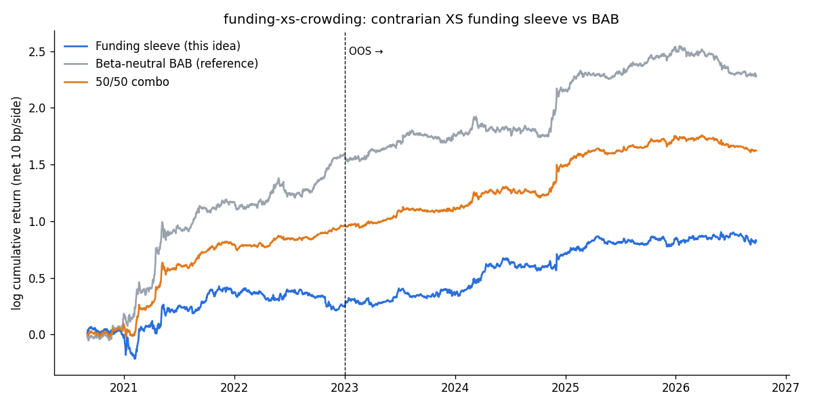

# Cross-sectional funding crowding — spot-priced (`funding-xs-crowding`, crypto-perps)

**Date:** 2026-09-25 · **Status: Failed** as a standalone alpha. Full-sample net Sharpe 0.80,
IS 0.59, OOS 0.99, deflated Sharpe 0.22 over ~200 configurations. **The side result worth
keeping:** the sleeve is uncorrelated with betting-against-beta (daily ρ = 0.04), so it may be
worth adding as a diversifier to the live crypto-alts BAB book (§7).

No acceptance criteria were given for this session. "Working" would have meant a
deployable, robust, stand-alone edge. This one is positive in both halves and survives cost,
lag and universe changes, but it is small, loses money in 2022 and is not significant after
multiple-testing adjustment.

## 0. Why this idea

The only previous crypto-perps idea, `funding-carry` (Sharpe 10 as a yield), is **undeployable**:
all of its return is funding cash flow, and neither simulated book accrues funding. Any
crypto-perps idea that can actually go live has to use perp data as a **signal** and earn
**price** returns on instruments the daily cache can price (spot `XXX-USD`). The spot-btc
`coinbase-premium` screen had already shown that funding is dead OOS as a *time-series* timing
signal for BTC. What was left untested was the **cross-section**. Funding measures leveraged-long
demand per coin: a persistently high rate means crowded longs paying up, and a low or negative rate
means shorts are crowded or longs have given up. The perp-carry literature (Schmeling, Schrimpf &
Todorov 2023 *Crypto Carry*, BIS WP 1087; He, Manela, Ross & von Wachter 2022) finds that
high-carry coins do poorly on price after crowding peaks. Hypothesis: long low-funding coins and
short high-funding coins, dollar-neutral, earns a price premium net of cost.

## 1. Data (new, left in `data/` for the next researcher)

| Store | Source | Content |
|---|---|---|
| `data/<SYM>_fundingRate.parquet` | `fapi/v1/fundingRate` REST, keyless | every settlement since listing, for 64 USDT-M perps (the 8 archive files were extended, not replaced). Same schema as the archive fetcher. |
| `data/<SYM>_premium_4h.parquet` | `fapi/v1/premiumIndexKlines` 4h | premium index OHLC for the same 64 perps |
| spot | yfinance `XXX-USD` daily cache | through `code/crypto-alts/shared/universe.py` (the book prices exactly these) |

Fetchers and the daily aggregation are in `code/crypto-perps/shared/funding_panel.py` (`PERP_OF`
maps yfinance tickers to Binance perps, including the `1000SHIB` and `1000BONK` contracts).

**Timing (no lookahead).** The yfinance day D closes at D+1 00:00 UTC. `daily_funding(lag_hours=8)`
only includes settlements at or before D+1 00:00 − 8h, i.e. the stamps at D 00:00, 08:00 and 16:00.
The 00:00 settlement that coincides with the close is pushed to the next day. For the premium
index, the day's mean uses 4h bars closing up to D 20:00. Weights computed at close D earn from
D+1 (`research_lib.backtest_xs`). A further +1-day lag is tested in exp06.

**Pre-registered before any result:** IS 2020-09-01 → 2022-12-31, OOS 2023-01-01 → 2026-09-24,
10 bp per side, and a universe of the point-in-time top-20 by trailing-90d median USD volume among
coins with a funded perp (≥ 30 days of funding, ≥ 120 closes, ≥ $1M volume). The universe holds
17–20 names in late 2020 and 20 after that. Some coins sit at the 0.01 %/8h default rate (11 %/yr)
for months, so the information in funding is mostly its *deviation* from that default.

## 2. exp01 — feature screen (52 cells)

Features: trailing-k funding mean (k = 1, 3, 7, 14, 30), funding changes (3−30, 7−60),
time-series z-score (7 vs 90d), share of sub-default stamps, funding residual after a
cross-sectional regression on 7/30d momentum, and 7/30d momentum as controls. Both signs,
q = 30 % long/short, holding 1 or 7 days (staggered tranches). Selected rows:

| cell | full | IS | OOS | turnover/yr |
|---|---|---|---|---|
| −fund_7 h7 (long low funding) | 0.51 | 0.33 | 0.69 | 44 |
| −fund_14 h7 | 0.56 | 0.40 | 0.71 | 30 |
| −fund_30 h1 | 0.71 | 0.26 | 1.06 | 36 |
| −fund_30 h7 | 0.61 | 0.09 | 1.03 | 20 |
| −fund7_resid_mom h7 | 0.58 | 0.56 | 0.62 | 45 |
| ±fund_chg, ±fund_z | all ≤ 0.07 | | | |
| ±mom_7, ±mom_30 | all ≤ 0 full | | | |

Only the **level** of funding works, and only contrarian. Every "+" (long high funding) cell is
negative in both halves. Changes and time-series z-scores do not work, so the signal is about
which coins are *structurally* crowded, not about fresh surges. Momentum is dead here, as it was
in crypto-alts. The residual version shows that funding is not just past returns in disguise.

## 3. exp02 — refinement grid (48 cells)

Lookback L ∈ {14, 30, 60, 90} × hold h ∈ {7, 14, 30} × {quantile q30, linear rank} ×
{dollar-neutral, beta-neutral to BTC (EWM-60 β)}. Every cell has a positive full-sample Sharpe
(0.21 – 0.71). **Grid mean: IS 0.19, OOS 0.69, full 0.46.** Beta-neutral legs add about 0.1 to
every cell. The dollar-neutral book carries β ≈ −0.05 because high-funding coins are slightly
higher-beta. The OOS-best cell (L30 h7 q30 β-neutral, 0.71 / 0.19 / 1.16) was *not* adopted
because it was picked with knowledge of OOS. The **IS-best** cell (L90 h30 lin β-neutral) gives
0.56 IS → **0.59 OOS**.

Leg decomposition (L30 h7, gross of cost): long-leg-minus-EW Sharpe 0.40 (IS −0.19), and
EW-minus-short-leg 0.85 (IS 0.52, OOS 1.09). **Most of the edge comes from shorting the
high-funding coins.**

## 4. exp03 — the uncompressed basis: premium index (80 cells)

Funding = premium + clamp(0.01 % − premium, ±0.05 %), so small premiums map to exactly 0.01 %.
The premium index keeps that information, so I expected it to be a better signal. **It is worse:**
the best cell is −prem_30 h7 β-neutral at 0.51 / 0.32 / 0.70, and 1–7-day premium features are
~0 or negative. The clamp removes noise rather than signal. What predicts is the persistent part
of funding outside the default band.

## 5. exp04 — absolute-level buckets

Forward 7d excess return (vs the EW universe) by annualised funding bucket, sampled every 7 days.
The relation is noisy and non-monotonic, and no bucket has |t| > 2.5 in both halves. Very negative
funding (< −20 %/yr) *under*performs (IS −178 bp/wk, t −2.5): those coins are in freefall, not
about to be squeezed. There is no tail event to trade, so the rank-based book is the right form.

## 6. exp05 — orthogonality to BAB, and the ETH/BTC pair (19 cells)

* **ETH/BTC pair** timed by the ETH−BTC funding spread (k = 3, 7, 14, 30, both signs, h 1/7):
  the best IS cell (−k7 h1, IS 1.50) is −0.12 OOS. **Dead.**
* **Versus betting-against-beta** (long low-β / short high-β tercile, β-neutral, 14d tranches, same
  universe): daily return correlation **0.04**, average cross-sectional rank correlation of the
  signals 0.09, loading of the funding sleeve on BAB 0.03, and alpha after BAB 0.64 full / 1.12 OOS.
  The funding sleeve is a genuinely separate return stream.

## 7. exp06 — honest selection and robustness

**Pre-declared ensemble** (no cell selection): mean cross-sectional rank of −funding over
L ∈ {14, 30, 60, 90}, q30, β-neutral, 7-day tranches. This is `strategy.py`.

| variant | full | IS | OOS | CAGR | MaxDD | turnover/yr |
|---|---|---|---|---|---|---|
| **ensemble, top-20, 10 bp** | **0.80** | **0.59** | **0.99** | 14.5 % | −24.7 % | 18.6 |
| cost 5 bp | 0.85 | 0.63 | 1.05 | | | |
| cost 20 bp | 0.70 | 0.51 | 0.88 | | | |
| +1 day extra lag | 0.75 | 0.58 | 0.91 | | | |
| top-15 universe | 0.56 | 0.05 | 1.00 | | | |
| top-30 universe | 0.68 | 0.53 | 0.82 | | | |
| BAB reference (top-20) | 1.79 | 2.73 | 1.04 | 45.7 % | −23.8 % | 7.7 |
| **50/50 funding + BAB** | **1.84** | 2.54 | **1.33** | 30.6 % | **−13.9 %** | 12.1 |

Average gross exposure is 0.97 (≈ 0.5 long / 0.5 short) and average net exposure is ≈ 0.

Calendar-year Sharpe of the funding sleeve: 2020 (Sep–Dec) −0.01, 2021 1.43, **2022 −0.64**,
2023 0.76, 2024 1.77, 2025 0.99, 2026 YTD −0.06. It loses in the 2022 bear market and has no
clear edge in two of the seven years.

**Multiple testing.** 52 + 48 + 80 + 16 + 3 = 199 configurations went through selection (plus
3 in exp07 and 18 robustness cells not used for selection). Deflated Sharpe of the ensemble's
OOS 0.99 at N = 199: **0.22** (i.e. not significant). For the combo: 0.51.

`exp07`: an IS-fixed funding-dispersion regime filter (sleeve on only when cross-sectional funding
std is above its IS median) raises IS to 0.96 but drops OOS to 0.47, the classic
overfitting signature. Not adopted.

## 8. Verdict

* **Standalone: Failed.** A robust sign (both halves, every lookback, 5–20 bp, extra lag,
  15/20/30-name universe), but the size is small: Sharpe 0.8, IS only 0.59, a losing 2022, and
  DSR 0.22. That is below every alpha deployed in this repo (≥ 1.2).
* **Binding constraint:** information content, not cost. The gross-of-cost Sharpe is only about
  0.9, and 10 bp costs remove about 0.1.
* **Worth a look for the crypto-alts book, not deployable from this PR:** BAB is already live as
  `live/crypto-alts/xs-momentum-neutral` (a regime-hedged variant). Adding this sleeve 50/50 to a
  plain β-neutral BAB raised OOS Sharpe from 1.04 to 1.33, nearly halved MaxDD, and cut the
  2026-YTD loss (BAB −1.84, combo −1.57). This combination was constructed after the fact and
  not validated against the live regime-hedged variant. It should be re-tested as a
  crypto-alts sleeve before anyone relies on it.

## 9. What was tried (all failed to reach a deployable standalone)

1. Funding level, 1–30d, both signs, 1/7d holding (only contrarian level works, ≤ 0.71).
2. Funding changes and TS z-scores: ≈ 0 or negative.
3. Funding residual on momentum: 0.58, so not just momentum.
4. 48-cell L × h × weighting × neutrality grid: mean OOS 0.69, IS 0.19.
5. Premium index (uncompressed basis), 80 cells: worse than funding.
6. Absolute-level buckets / tails: no monotone relation; negative funding is not a squeeze signal.
7. ETH/BTC pair on the funding spread: dead OOS.
8. Funding-dispersion regime filter: IS↑ OOS↓, overfit.

## 10. Files

```
code/crypto-perps/shared/funding_panel.py            REST fetchers (funding, premium 4h), daily lag-safe aggregation
code/crypto-perps/funding-xs-crowding/common.py      data, PIT universe, splits, evaluation
code/crypto-perps/funding-xs-crowding/exp01_screen.py  (+ exp01_results.csv)
code/crypto-perps/funding-xs-crowding/exp02_refine.py  (+ exp02_results.csv)
code/crypto-perps/funding-xs-crowding/exp03_premium.py (+ exp03_results.csv)
code/crypto-perps/funding-xs-crowding/exp04_buckets.py
code/crypto-perps/funding-xs-crowding/exp05_orthogonality_pair.py
code/crypto-perps/funding-xs-crowding/exp06_honest.py  (+ exp06_results.csv, exp06_nets.parquet)
code/crypto-perps/funding-xs-crowding/exp07_dispersion.py
code/crypto-perps/funding-xs-crowding/exp08_figure.py  -> past_research/.../equity.png
code/crypto-perps/funding-xs-crowding/strategy.py      target_weights(close, volume, funding)
```


