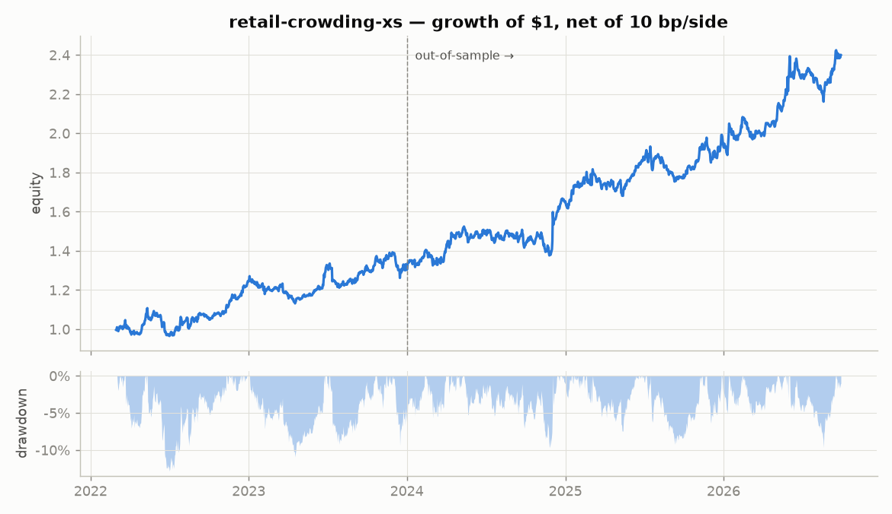

# Retail crowding, cross-sectional — Binance global long/short account ratio (`retail-crowding-xs`, crypto-perps)

**Date:** 2026-09-30 · **Status: Working** (moderate). Net Sharpe **1.25 full / 0.99 IS / 1.43 OOS**,
CAGR 21 %, MaxDD −12.8 %, 10 bp/side, beta to BTC 0.005. No acceptance criteria were given for this
session. Caveats (§8): only 4.5 years of data, deflated Sharpe 0.65, and part of the edge is a
static coin tilt.

## 0. Idea and why it is in `crypto-perps`

Every 5 minutes Binance publishes, for each USD-M perpetual, the **global long/short account ratio**:
the number of accounts net long divided by the number net short. It is a head count, so the many
small accounts dominate it. It measures where the retail crowd is positioned in each coin's perp.

On BTC this ratio, used contrarian, is the one perp-positioning feature that survived out of sample
(spot-btc `perp-crowding`, 1.25 / 1.53 OOS, deployed). Nobody had tested it *across coins*.

Hypothesis: coins whose retail accounts are most net long are crowded retail favourites. They
underperform. Coins where retail is least long outperform. Trade it long/short on spot, beta-neutral.

This is a perp-positioning signal. The P&L is on spot, because the sim book prices spot closes but
accrues no funding (see `funding-carry`).

## 1. Data

- **New store:** `data/<SYM>_metrics_5m.parquet` for all 64 perps of `funding_panel.PERP_OF`.
  - Fetched by `code/crypto-perps/shared/metrics_panel.py` (threaded, resumable).
  - Columns: OI in coins and USDT, top-trader account and position ratios, the global account
    ratio, and the taker long/short volume ratio.
  - **The archive starts 2021-12-01 for every perp except BTC (2020-09-01)**, checked against the
    S3 listing. Later listings start at their first file.
- **Daily value:** the last 5-minute stamp *before 23:00 UTC* of day D, via `daily_metrics`.
  - The archive stamp is the start of the window. The REST feed publishes the same value 5 minutes
    later: REST 23:00 = 2.5907 = archive 22:55 2.590851 on DOGE.
  - The daily close at which weights are set is D+1 00:00, so there is at least a 1 h margin.
- **Live:** `metrics_panel.fetch_rest` pages `/futures/data/globalLongShortAccountRatio` and
  subtracts the 5 minutes.
  - It matches the archive to 7e-4 (REST rounds to 4 decimals) on 1,215 overlapping stamps.
- **Prices:** yfinance `XXX-USD` daily closes, the same panel the live alt books use.

**Pre-registered before any result** (`common.py` docstring):
- **Universe:** PIT top-20 by trailing-90d median USD volume among the 64 coins. Filters: ≥ 60 days
  of ratio history, ≥ 120 closes, ≥ $1M median volume. BTC is eligible.
- **Split:** IS 2022-03-01 → 2023-12-31 (the first 90 days are warm-up), OOS 2024-01-01 → 2026-09.
- **Cost:** 10 bp per side.
- **Weights:** set at the close of D, applied from D+1 (`research_lib.backtest_xs`).
- The universe always holds exactly 20 names.

## 2. exp01 — feature screen (20 cells)

Feature: x = log(ratio). Five pre-declared normalisations × both signs × hold 1 day / 7-day tranches.
Book: q30 long/short, beta-neutral.

| cell (contrarian = short high ratio) | full | IS | OOS | turnover/yr |
|---|---|---|---|---|
| **−raw, h7** | **1.25** | **0.98** | **1.43** | 31 |
| −raw, h1 | 0.47 | 0.25 | 0.63 | 124 |
| −dm90 (x − 90d mean), h7 | 0.55 | 1.08 | 0.19 | 49 |
| −z90, h7 | 0.57 | 0.98 | 0.27 | 52 |
| −exmed (x − expanding median, the BTC rule), h7 | 0.65 | 0.83 | 0.54 | 39 |
| −chg7, h7 | 0.04 | 0.05 | 0.04 | 82 |
| every "+" (follow the crowd) cell | −1.2 … −2.5 | | | |

Contrarian mean daily IC at 7 days:

| normalisation | IS IC7 (t) | OOS IC7 (t) |
|---|---|---|
| raw level | 0.070 (2.6) | 0.046 (2.1) |
| dm90 | 0.025 (1.0) | −0.002 (−0.1) |
| exmed | 0.022 (0.9) | −0.031 (−1.3) |

**The information is in the cross-sectional level of the ratio, not in its time variation.**

**Selection, stated plainly:**
- By IS *Sharpe*, the best contrarian cell is −dm90 h7 (1.08 vs 0.98), and it earns 0.19 OOS.
- By IS *IC*, the raw level is clearly best (t 2.6 vs ≤ 1.0), and it earns 1.43 OOS.
- The raw level is also the cell the mechanism names ("which coins is retail crowded into").
- The **selection-free ensemble of all five normalisations** earns **0.80 / 1.06 IS / 0.61 OOS**.
  That is the number to hold against the headline if you distrust the choice.

1-day holding loses to cost: 124 turns/yr × 10 bp against a slow signal.

## 3. exp02 — what the raw level is (and is not)

Mean daily cross-sectional Spearman correlation of the raw ratio with:

| mom7 | mom30 | mom90 | beta | vol30 | log mcap | funding 30d | top-trader acc | top-trader pos |
|---|---|---|---|---|---|---|---|---|
| −0.34 / −0.10 | −0.40 / −0.20 | −0.46 / −0.27 | +0.09 / +0.12 | +0.13 / −0.05 | −0.13 / +0.16 | +0.11 / +0.18 | +0.98 / +0.93 | +0.15 / +0.28 |

(IS / OOS.) Retail is most net long in recent *losers* ("buy the dip").

| variant (h7) | full | IS | OOS |
|---|---|---|---|
| base −raw | 1.25 | 0.98 | 1.43 |
| base, gross of cost | 1.44 | 1.17 | 1.63 |
| −raw, residual on mom30 | 1.25 | 0.78 | 1.54 |
| −raw, residual on mom90 | 1.13 | 0.65 | 1.45 |
| −raw, residual on funding 30d | 1.18 | 1.24 | 1.14 |
| −raw, residual on beta | 0.79 | 0.70 | 0.85 |
| −raw, residual on vol30 / log mcap | 1.12 / 1.12 | | |
| −raw, residual on mom7/30/90 + beta + vol + funding | 0.50 | 0.48 | 0.51 |
| … + log mcap | 0.30 | 0.66 | 0.03 |
| **frozen IS coin means**, held unchanged OOS | 0.73 | 0.58 | **0.83** |
| within-coin only (x − expanding mean) | 0.61 | 0.84 | 0.46 |
| −raw 7d-smoothed / h14 / h30 | 1.09 / 1.16 / 0.94 | | |
| control: +mom30 / −mom30 | −0.42 / 0.01 | | |
| control: −funding 30d (funding-xs-crowding) | 0.73 | −0.15 | 1.28 |
| control: BAB (low-beta) | 1.29 | 1.62 | 1.07 |
| −top-trader account ratio | 0.86 | −0.14 | 1.36 |
| −top-trader position ratio | 1.16 | 0.88 | 1.32 |

Daily P&L correlation of the base with: momentum 0.25, funding sleeve 0.27, **BAB 0.04**.

**Reading:**
- It is *not* reversal. Short-term reversal (−mom30) earns 0.01.
- It is not momentum either. It survives residualisation on each of momentum, funding, vol and size
  individually.
- Beta and the combination of all controls absorb about half of it.
- **About 60 % of the OOS result is a slow coin preference.** A book frozen on IS coin averages still
  earns 0.83 OOS. The live signal adds ~0.6 on top.
- The book is short DOGE, ADA, DOT, XRP, SHIB and AVAX 74–92 % of the time.
- It is long TRX, BTC and BCH 85–91 % of the time, and BNB / ETH about half the time.

## 4. exp03 — is it just "majors beat alts in 2022-26"? No.

| variant | full | IS | OOS |
|---|---|---|---|
| base | 1.25 | 0.98 | 1.43 |
| **benchmark: long BTC+ETH / short EW alts, beta-neutral** | **0.23** | 0.16 | 0.28 |
| signal inside alts only (BTC, ETH removed) | 1.08 | 0.98 | 1.14 |
| signal inside alts only (BTC, ETH, BNB, TRX removed) | 0.81 | 0.86 | 0.78 |
| cost 5 / 20 / 30 bp | 1.35 / 1.05 / 0.85 | | 1.53 / 1.23 / 1.03 |
| +1 day execution lag | 1.25 | 0.88 | 1.49 |
| q20 / q50 / linear rank | 1.16 / 1.28 / 1.23 | | |
| top-15 / top-30 universe | 0.94 / 1.09 | 0.81 / 1.35 | 1.03 / 0.92 |
| rank(level) + rank(within) | 1.03 | 0.85 | 1.15 |

- Correlation with the majors-vs-alts benchmark is 0.11.
- The extra day of lag costs nothing, so this is not microstructure.

**Calendar years** (Sharpe; base / alts-only / benchmark):

| year | base | alts-only | benchmark |
|---|---|---|---|
| 2022 | 1.56 | 1.58 | 0.23 |
| 2023 | 0.42 | 0.14 | 0.09 |
| 2024 | 1.31 | 0.22 | 0.42 |
| 2025 | 1.24 | 0.71 | 1.16 |
| 2026 YTD | 1.90 | 1.67 | −1.21 |

Positive in every year.

## 5. exp04 — validation

- **Legs, gross:** long leg minus EW universe 1.14 (IS 1.19 / OOS 1.11); EW minus short leg 1.46
  (1.41 / 1.51). Both legs earn it.
  - Average long gross 0.51, short 0.47, net +0.04. Realised beta to BTC **0.005**.
- **Versus the live `crypto-alts/alt-sleeve-blend`** (its research weights, same window):
  - daily correlation **0.05** (IS −0.04, OOS 0.11);
  - an equal-risk 50/50 combination has Sharpe **1.96 full / 1.98 IS / 1.96 OOS**, against the
    blend's own 1.60 / 1.83 / 1.49.
  - This is the most useful property of the sleeve.
- **Lookahead truncation test:** weights recomputed from inputs cut at T equal the full-sample
  weights at T for five dates (max difference 0). The daily value on DOGE 2024-03-05 equals the
  last raw 5-minute stamp before 23:00.
- **Deflated Sharpe** at N = 57 selection-relevant cells (exp01–03): **0.65** full, 0.57 OOS.
  Not significant at 95 %.
- **Stationary block bootstrap** (10-day blocks): Sharpe 5 / 50 / 95 % = 0.52 / 1.26 / 1.92,
  P(Sharpe > 0.5) = 0.955.
- **Rolling 12-month Sharpe:** min 0.02, median 1.24. Monthly hit rate 64 %.
- **Worst day:** −5.2 % on 2023-07-13, the SEC ruling in favour of XRP, which was in the short leg.

## 6. exp05 — implementation sensitivity (not selection)

| variant | full | IS | OOS |
|---|---|---|---|
| base: last stamp < 23:00, ≥ 60 days of history | 1.25 | 0.98 | 1.43 |
| last stamp < 20:00 | 1.21 | 0.92 | 1.40 |
| last stamp < 12:00 | 1.14 | 0.93 | 1.28 |
| daily mean of stamps | 1.21 | 0.97 | 1.37 |
| ≥ 30 / ≥ 7 days of history | 1.27 / 1.26 | | |
| composite with top-trader position ratio | 1.34 | 0.69 | 1.66 |

The composite is **not adopted**: IS got worse and only OOS improved.

## 7. The spec (exp06, `strategy.target_weights` with defaults)

| | Sharpe | CAGR | Vol | MaxDD | Sortino | NW t |
|---|---|---|---|---|---|---|
| **Full 2022-03 → 2026-09** | **1.25** | 21.0 % | 16.3 % | −12.8 % | 1.87 | 2.9 |
| IS 2022-03 → 2023-12 | 0.99 | 16.0 % | 16.4 % | −12.8 % | 1.26 | 1.4 |
| **OOS 2024-01 → 2026-09** | **1.43** | 24.5 % | 16.3 % | −9.7 % | 2.46 | 2.6 |

- **Book:** turnover 30.7× per year; average gross 0.975, max 1.0; net +0.04; about 9 names long and 9 short.
- **Cost 5 / 20 / 30 bp:** 1.35 / 1.05 / 0.86 full.
- **By year:** 2022 +24.6 % (1.57), 2023 +5.5 % (0.43), 2024 +25.5 % (1.31), 2025 +18.1 % (1.24),
  2026 YTD +23.2 % (1.90).
- `strategy.py` reproduces the exp04 weights to 0.003 when fed the full price history. Feeding it
  history that starts at 2021-12 changes Feb–Apr 2022 weights through beta and volume warm-up.



## 8. Caveats — read before sizing

1. **Short sample.** The alt archive begins in December 2021, so this is 4.5 years, one bear market
   and one recovery. The DSR of 0.65 says the result is suggestive, not proven.
2. **Selection ambiguity** (§2). The selection-free ensemble earns 0.80 / 0.61 OOS.
3. **Static tilt.** About 60 % of OOS is a coin preference: long TRX / BTC / BCH, short
   DOGE / ADA / XRP. It would suffer if retail favourites re-rated as a group.
4. **Concentration.** TRX's real +80 % pump on 2024-12-03 contributed +10.2 % in one day.
   - Without that day: 1.16 full / 1.30 OOS.
   - Winsorised at 1/99 %: 1.41 / 1.42 / 1.41.
   - Leave-one-coin-out: min 1.01 (without TRX), median 1.24.
   - Without TRX the IS Sharpe is only 0.61.
5. **Survivorship.** The 64-coin list comes from yfinance, which serves no delisted coins, so LUNA and
   FTT are missing from 2022. Retail was heavily long both as they collapsed, which would probably
   have *helped* the short leg.

## 9. Files

```
code/crypto-perps/shared/metrics_panel.py        archive fetcher, daily lag-safe panel, REST reader
code/crypto-perps/retail-crowding-xs/common.py   pre-registered universe/split/cost, helpers
  exp01_screen.py      (+ exp01_results.csv)  normalisation × sign × hold screen, ICs
  exp02_decompose.py   (+ exp02_results.csv)  controls, residuals, frozen fixed effect
  exp03_robust.py      (+ exp03_results.csv)  benchmark, alts-only, cost/lag/q/universe
  exp04_validate.py    legs, alt-blend correlation, truncation test, DSR, bootstrap
  exp05_timing.py      (+ exp05_results.csv)  sampling time, history rule, composite
  exp06_final.py       spec run + figures
  strategy.py          target_weights(close, volume, ls_ratio)
alphas/crypto-perps/retail-crowding-xs/spec.md, equity.png, yearly_sharpe.png
```

Variants evaluated: 20 + 22 + 15 + 6 = 63 configurations. The 57 of exp01–03 enter the DSR; exp05 is
implementation sensitivity. There are also 64 leave-one-out and 4 exclusion runs.
