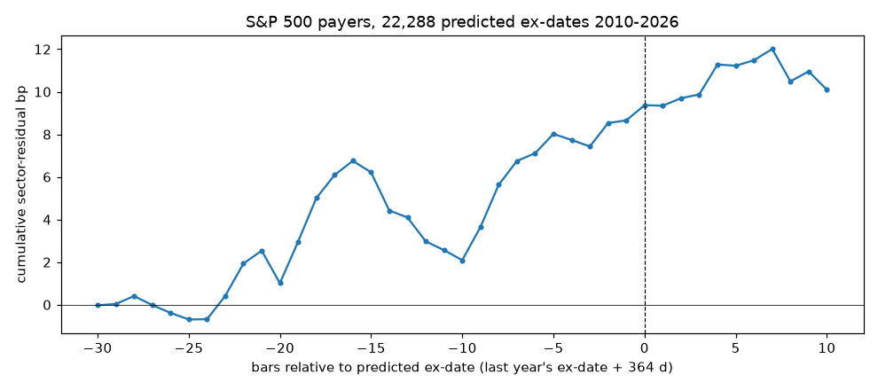

# dividend-month-premium — predictable dividend months and the pre-ex-date run-up

**Status: Failed.** The effect exists in S&P 500 payers only for the **high-yield tercile**:
+15 bp sector-residual over the 20 bars before a *predicted* ex-date, against about 0 for low-
and mid-yield payers. Books built on it have gross Sharpe of at most 0.53, and every one is
negative at 5 bp per side. The monthly Hartzmark-Solomon book earns 0.18 gross and −0.35 net.
Same verdict as the earnings pre-announcement run-up: real, tiny, and eaten by the spread.

Date: 2026-09-27 · Asset class: us-large-cap · IS 2011–2017 / OOS 2018–2026-09 · 5 bp per
side · 7 event windows + 3 yield terciles + 3 monthly books × 2 costs + 6 event books × 2
costs ≈ 30 variants.

Code: `code/us-large-cap/dividend-month-premium/` (`event_study.py`, `screen1.py`,
`screen2_eventbook.py`, `figures.py`; CSVs next to them). Data:
`data/SP500_actions.parquet` (30 k dividend and split events, 553 tickers, from
`code/us-large-cap/shared/fetch_actions.py`).

## 1. Idea

Hartzmark & Solomon (2013, *The dividend month premium*, JFE) find that stocks earn ~40 bp/month
abnormal returns in months when they are predicted to pay a dividend. They attribute this to
demand from investors who treat dividends as income ("free dividends" fallacy). The premium
is concentrated in the days before the ex-date and in high-yield names, and the date is
predictable a year ahead because payers keep their calendar. The earnings-event-drift cycle
flagged ex-dividend run-ups as "same magnitude class, same cost problem expected". This
cycle tests that directly, and conditions on yield, which is where the demand should sit.

## 2. Method

* Ex-dates come from Yahoo actions. The **predicted ex-date = an ex-date one year earlier +
  364 days**, so it is known a year in advance, and the event exists even if the dividend is
  later cut. 22,288 predicted events 2010–2026. 96 % were followed by an actual ex-date
  within ±10 days.
* Returns are total-return: the cache is dividend-adjusted, so the ex-date drop is not a
  loss. Residuals are sector-residual simple returns.
* Trailing-12-month dividend yield ranks are taken 21 bars before the event.

## 3. Results

### 3.1 Event time (`event_study.py`, all payers, bp)

| window (bars vs predicted ex-date) | mean | t | IS | OOS |
|---|---|---|---|---|
| [−20, −1] | +6.1 | 1.5 | +3.1 | +8.3 |
| [−10, −1] | +6.1 | 2.1 | −4.2 | +13.6 |
| [−5, −1] | +1.5 | 0.8 | | |
| [0, +5] | +2.6 | 1.2 | | |

### 3.2 By yield tercile (`screen1.py`)

| tercile | N | [−20, −1] | [−10, −1] |
|---|---|---|---|
| low | 3,842 | +0.9 | −3.6 |
| mid | 8,770 | −0.5 | +5.4 |
| **high** | 9,009 | **+15.1** | **+11.2** |

The demand story shows up where it should, in high-yield names. By year, though, the
[−20, −1] mean swings from −24 bp (2016, 2023) to +53 bp (2021), with no trend.

### 3.3 Books

| book | gross Sh | net 5 bp | IS / OOS (net) | turnover/yr | names |
|---|---|---|---|---|---|
| HS monthly, all payers, sector-neutral L/S | 0.18 | −0.35 | −0.78 / −0.04 | 18.7 | |
| HS monthly, high-yield only | 0.18 | −0.16 | −0.27 / −0.09 | 19.9 | |
| HS monthly, high-yield long vs EW market | 0.11 | −0.05 | | 13.3 | |
| **event book, high-yield, [−20, −1], sector-hedged** | **0.53** | −0.17 | 0.08 / −0.30 | 29.8 | 45 |
| event book, high-yield, [−10, −1] | 0.52 | −0.50 | | 59.6 | 23 |
| event book, all payers, [−20, −1] | 0.47 | −0.73 | | 25.6 | 108 |

At 0 bp the best event book is 0.53 (IS 0.99 / OOS 0.29). The edge is ~15 bp per event
against a 10 bp round trip plus the sector hedge's turnover.

## 4. Why it fails

Large-cap dividend capture is cheap and heavily arbitraged. What survives is a ~15 bp
price-pressure effect in high-yield names, and that is the size of one round trip. No
holding-period choice escapes this: longer windows dilute the edge, shorter ones multiply
turnover.

## 5. Not tried

Using the predicted dividend month as a zero-cost **tie-breaker** inside another monthly book
(e.g. `residual-momentum`). The flag flips every month for quarterly payers, so it adds
turnover rather than riding existing turnover. Worth a look only if a book already trades
the same names monthly. Special dividends, and dividend initiations/increases (a separate
signalling literature), were not tried.
