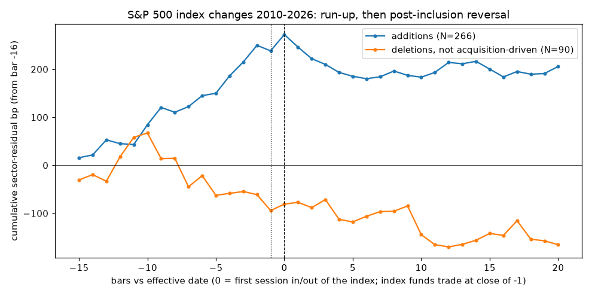

# index-reconstitution — S&P 500 additions/deletions: pre-inclusion run-up and post-inclusion reversal

**Status: Failed** as a standalone strategy (too sparse); used as a sleeve in
`large-cap-sleeve-blend` (Working). The tradeable part is the **post-inclusion reversal**:
short each added name at the close of its effective session, sector-hedged, and cover 5
bars later. Mean +86 bp per event (t 2.9), IS +78 (t 2.2) / OOS +93 (t 2.0), positive in 12
of 17 years. A sparse book of it (25 % of capital per event) earns net **0.46 full / 0.66 IS
/ 0.41 OOS** at 5 bp. It is active only 24 % of days and uncorrelated with every other
sleeve (|ρ| ≤ 0.09).

Date: 2026-09-27 · Asset class: us-large-cap · IS 2011–2017 / OOS 2018–2026-09 · 5 bp per
side · 267 additions and 123 priced deletions 2010–2026 · ~45 event windows/subsets + 6 books.

Code: `code/us-large-cap/index-reconstitution/` (`event_study.py`, `screen1.py`,
`screen2_quarterly.py`, `screen3_sleeve.py`, `figures.py`, **`strategy.py`** →
`recon_weights`). New shared fetcher: `code/us-large-cap/shared/fetch_sp500_changes.py`
(Wikipedia constituents + changes, rolls `sp500_ticker_start_end.csv` forward).

## 1. Idea

When a stock joins the S&P 500, index funds must buy it at the close before the effective
date. The classic index effect is a run-up from announcement to effective date, then a
partial reversal once the forced buying is done (Harris-Gurel 1986; Lynch-Mendenhall 1997).
Greenwood & Sammon (2022, *The Disappearing Index Effect*) show that the announcement return
has shrunk from ~7 % to ~1 %. The question here is whether the **post-inclusion price-pressure
reversal**, which needs no announcement feed because the effective date is public in
advance, still pays after costs. The mechanism has nothing to do with the other ideas this
session (factors, momentum, text, insiders).

## 2. Data and timing

* Events come from Wikipedia's *Selected changes* table (effective date, added/removed ticker,
  reason), 2010–2026. "Acquisition-driven" means the reason mentions an acquisition, merger
  or spin-off. The table now lives on *Historical components of the S&P 500*;
  `fetch_sp500_changes.py` reads it.
* Bar 0 is the first session on or after the effective date (changes take effect before the
  open), and index funds trade at the close of bar −1.
* **Announcement dates are not in the data**, so windows that start before bar −1 are
  descriptive only.
* Deleted names are often not priced (acquired). 123 of ~280 deletions have prices around the
  event.
* Returns are sector-residual (vs the EW of sector members) and simple. Outside membership
  windows the panel's bad-data mask does not apply, so the event study drops tickers with 3+
  daily moves above 40 % (recycled symbols) and masks isolated bars. The deployable backtest
  uses **raw** returns, so a genuine squeeze on a shorted name counts; results are identical.

## 3. Results

### 3.1 Event time (`event_study.py`, sector-residual bp)

| window (bars) | additions (N 267) | t | deletions, cap-driven (N 90) | t |
|---|---|---|---|---|
| [−10, −1] (not tradeable) | **+197** | 4.3 | −153 | −1.8 |
| [−5, −1] (not tradeable) | +94 | 2.5 | −73 | −1.3 |
| bar 0 | +32 | 1.4 | +14 | 0.4 |
| **[+1, +5]** | **−86** | **−2.9** | −37 | −0.7 |
| [+1, +20] from close of bar −1 | −32 | −0.6 | −71 | −0.5 |
| [+5, +60] | +118 | 1.2 | +242 | 1.0 |

The run-up is still visible, at +2 % over the ten sessions to bar −1, and **five sessions
after inclusion roughly half of it reverses**. Deletions show the mirror image (a pre-deletion
drop, then a noisy rebound of +2.5 % over six months, t ≤ 1.7). That is too few events and
too noisy to use.

### 3.2 Short additions from the close of bar 0 (`screen1.py`)

| hold H | mean bp | t | IS | OOS | hit rate |
|---|---|---|---|---|---|
| 1 | +28 | 1.6 | +25 | +30 | 52 % |
| 3 | +63 | 2.3 | +37 | +85 | 53 % |
| **5** | **+86** | **2.9** | **+78 (t 2.2)** | **+93 (t 2.0)** | 56 % |
| 10 | +92 | 2.2 | +70 | +110 | 52 % |
| 20 | +66 | 1.3 | +22 | +102 | 52 % |

H = 5 is the textbook window (the pressure unwinds within a week). It holds in both halves
and for both acquisition-replacement and market-cap additions (+96 / +73). By year:
2010 +202, 2011 +385, 2012 +94, 2013 −133, 2014 +113, 2015 +1, 2016 +34, 2017 +94, 2018 +18,
2019 +84, 2020 +226, 2021 +272, 2022 −43, 2023 −39, 2024 +173, 2025 −48, 2026 +230.

### 3.3 Quarterly-rebalance run-up (`screen2_quarterly.py`)

Quarterly-rebalance changes are announced after the close on the first Friday of
Mar/Jun/Sep/Dec and take effect after the third Friday. For the 77 quarterly additions:

| | mean bp | t | median |
|---|---|---|---|
| reaction on the session after the first Friday | +213 | 4.1 | +18 |
| drift from that close to the close of bar −1 (tradeable *if* the schedule held) | +114 | 1.7 | +126 |
| [+1, +5] after inclusion | −88 | −1.9 | −58 |

The low median reaction says the first-Friday schedule did not hold for every name and year.
When the announcement came later, a long entered after the first Friday front-runs it. **This
leg is therefore excluded from the deployable sleeve** and kept only as `legA=True` in
`strategy.py` for research.

### 3.4 Sparse event books (fixed 0.25 of capital per event, sector-hedged, net 5 bp)

| book | full | IS | OOS | gross Sh | vol | days active | max gross |
|---|---|---|---|---|---|---|---|
| **leg B: short additions [+1, +5]** (`strategy.py` default) | **0.46** | 0.66 | **0.41** | 0.60 | 6.2 % | 24 % | 1.95 |
| leg A: quarterly run-up (research only) | 0.24 | 0.43 | 0.23 | 0.29 | 4.6 % | 8 % | 2.0 |
| A + B | 0.50 | 0.71 | 0.47 | 0.63 | 7.7 % | 30 % | 2.5 |
| leg B, 0 bp | 0.57 | 0.79 | 0.52 | | | | |

## 4. Why Failed standalone, and why it is still useful

About 16 additions a year cannot support a standalone book. The sleeve is empty 76 % of the
time, and a 25 %-of-capital single-name short carries squeeze risk (max DD −12 %). Its value
is diversification: correlation to residual momentum is −0.08, and to the fundamental and
text sleeves 0.04 / −0.01. It lifts the four-sleeve blend's OOS Sharpe from 0.70 (without it)
to 0.81.

## 5. Variants and multiple testing

The event study looked at ~45 window × side × kind cells over the full sample before H = 5
was chosen. H = 5 is the literature's standard window, and IS and OOS are similar
(+78 / +93). The choice of window is still an in-sample-informed decision, and the
blend report says so.

## 6. Live requirements

`fetch_sp500_changes.py` must run before each close so an addition is known by its effective
session. Wikipedia is normally edited on announcement day, days ahead. New members must also
be added to the price cache (`fetch_universe.py`).
