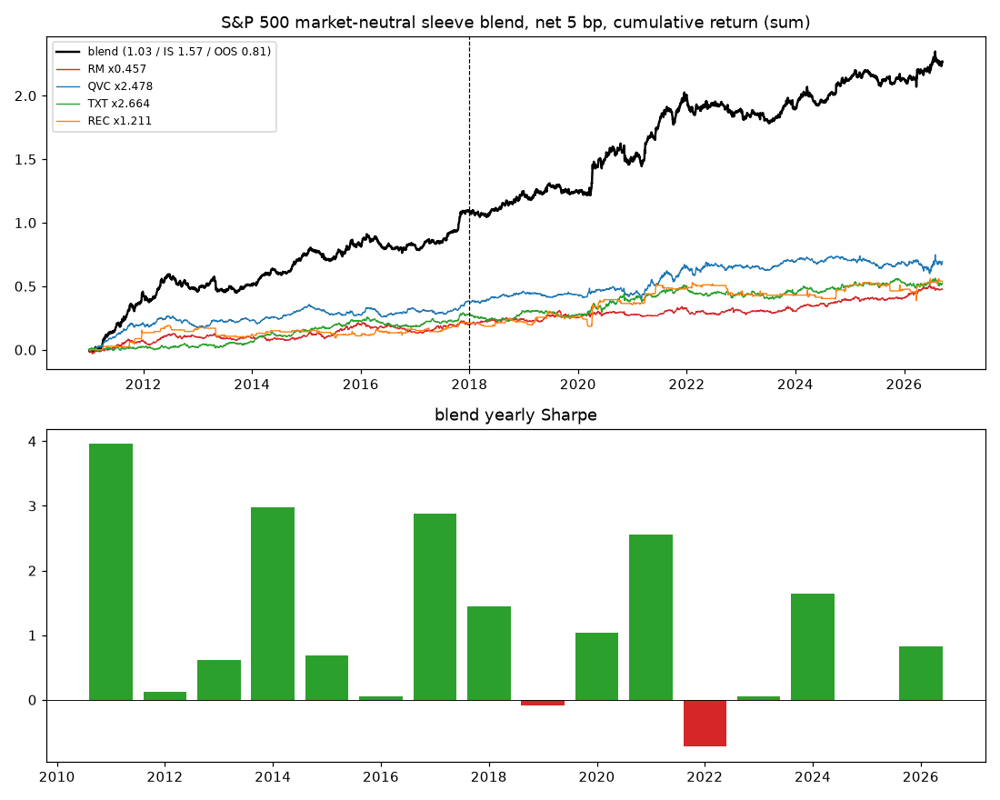

# large-cap-sleeve-blend — four uncorrelated S&P 500 market-neutral sleeves, equal risk

**Status: Working** (recommended deploy for this asset class). Net Sharpe **1.03 full /
1.57 IS / 0.81 OOS** at 5 bp per side. CAGR is 14.4 % (OOS 12.9 %), max drawdown −23 %, vol
14 % (OOS 16.6 %). Beta to the EW member market is −0.00, and correlation to SPY is 0.06.
Sleeve multipliers are fixed on 2011–2017 volatility only, and every sleeve's weights come
from its own `strategy.py`. The book trades the whole S&P 500 (≈ 430 names held) at average
gross 4.4 (max 6.3), turnover 42× a year.

Date: 2026-09-27 · Asset class: us-large-cap · IS 2011-01 → 2017-12 / OOS 2018-01 → 2026-09
(split fixed in advance, same as every us-large-cap cycle) · 5 bp per side on every weight
change (weight-level netting across sleeves).

Code: `code/us-large-cap/large-cap-sleeve-blend/` — **`strategy.py`** (`blend_weights`),
`calibrate.py` (multipliers + leave-one-out), `blend.py` (all sleeve subsets, return level),
`lookahead_check.py`, `figures.py`. Spec: `alphas/us-large-cap/large-cap-sleeve-blend/spec.md`.

## 1. Idea

No single large-cap signal this session clears ~0.65 OOS. The per-trade edges are small, and
each mechanism has its own bad years. The four that survived are economically unrelated:

| sleeve | mechanism | standalone net full / IS / OOS | report |
|---|---|---|---|
| **RM** residual momentum | slow diffusion of firm-specific news | 0.63 / 0.61 / 0.63 (10 % vol) | `residual-momentum` (**Working**) |
| **QVC** fundamental quality blend | cash profitability, payout, at constant beta | 0.68 / 1.17 / 0.47 | `quality-value-composite` |
| **TXT** filing-text similarity | stable-disclosure firms out-perform | 0.55 / 0.86 / 0.40 | `filing-text-changes` |
| **REC** post-inclusion reversal | index-fund price pressure unwinds | 0.46 / 0.66 / 0.41 | `index-reconstitution` |

Daily correlations are low across all pairs:

| | RM | QVC | TXT | REC |
|---|---|---|---|---|
| RM | 1 | 0.05 (OOS 0.00) | 0.22 (0.23) | −0.08 (−0.09) |
| QVC | | 1 | 0.34 (0.43) | 0.04 (0.05) |
| TXT | | | 1 | −0.01 (0.01) |

So an equal-risk combination should roughly double the Sharpe of its parts.

## 2. Construction

* Each sleeve comes from its own `strategy.py` with the defaults in its report. RM and the
  vol-management overlay are at 10 % vol; QVC and TXT are unlevered, beta-hedged,
  dollar-neutral stock books; REC is short 25 % of capital per addition, sector-hedged.
* Multipliers: inverse IS (2011–2017) vol of each sleeve's net returns (equal risk), times the
  leverage that puts the IS blend at 10 % vol. **MULT = RM 0.457, QVC 2.478, TXT 2.664,
  REC 1.211** (IS equal-risk weights 0.067 / 0.364 / 0.391 / 0.178, leverage ×6.81).
* `blend_weights(X) = Σ MULT_k · W_k`. The weights are summed before costs, so opposite
  trades net.

## 3. Results (`calibrate.py`, weight-level, net)

| | full | IS | OOS | CAGR | max DD | vol | turnover/yr | avg / max gross |
|---|---|---|---|---|---|---|---|---|
| **blend, 5 bp** | **1.03** | 1.57 | **0.81** | 14.4 % | −23.0 % | 14.1 % | 42 | 4.44 / 6.29 |
| blend, 2 bp | 1.12 | 1.70 | 0.89 | 15.9 % | −21.5 % | | | |
| blend, 10 bp | 0.88 | 1.35 | 0.69 | 12.1 % | −25.4 % | | | |
| without RM | 0.88 | 1.56 | 0.66 | | | | | 5.13 / 7.24 |
| without QVC | 0.90 | 1.22 | 0.76 | | | | | 4.21 / 6.66 |
| without TXT | 1.00 | 1.40 | 0.82 | | | | | 3.17 / 5.89 |
| without REC | 0.91 | 1.37 | 0.70 | | | | | 4.69 / 5.28 |

Yearly Sharpe: 2011 4.0, 2012 0.1, 2013 0.6, 2014 3.0, 2015 0.7, 2016 0.1, 2017 2.9 |
2018 1.4, 2019 −0.1, 2020 1.0, 2021 2.6, 2022 −0.7, 2023 0.1, 2024 1.6, 2025 0.0, 2026 0.8.
In the OOS years there are three near-zero years and one negative (2022, the growth-to-value
rotation), and no year below −1.

Every subset, return level (`blend.py`): the best pair is RM+QVC, 0.90 / 1.17 / 0.74. The
triples range 0.88–0.99 full. With the residualised text signal instead of raw (chosen after
an OOS-informed diagnostic, **not** the headline) the blend is 1.04 / 1.41 / 0.88.

## 4. Honesty checks

* **Lookahead / live consistency** (`lookahead_check.py`): every input is cut at seven dates
  (mid-month, month-end, and two REC event days). Prices are re-based to what a download on
  that date would show (dividend and split adjustment undone per ticker). Weights on the cut
  date match the full-sample weights to **< 1e-6 for all four sleeves**. This check found
  two point-in-time bugs in the fundamentals reader (tag priority and "nearest period" joins
  that could use later-filed rows). Both are fixed, and every number in this session's
  reports is from the fixed reader.
* **Selection**:
  * RM is the literature specification.
  * QVC's sleeves were chosen on IS Sharpe only.
  * TXT's metric was the best IS level metric.
  * REC's 5-bar window is the textbook one, but it was fixed after looking at full-sample
    event means (IS +78 / OOS +93 bp, so the halves agree).
  * Excluding REC entirely gives 0.70 OOS.
  * The multipliers use only 2011–2017 vol.
* **Multiple testing**: this session evaluated ≈ 500 books across seven ideas. The blend is
  not the best of those books. It is the pre-committed combination of the four sleeves that
  survived, and its OOS (0.81) is below its IS (1.57): about half of the IS Sharpe decays, in
  line with the individual sleeves.
* **Costs**: 5 bp per side on every weight change, including beta hedges, vol-scaling and
  REC's sector baskets. Large-cap quoted spreads are 1–5 bp. At 10 bp the OOS Sharpe is
  still 0.69.
* **Survivorship**: yfinance has no delisted names (DATA.md §5). Membership is point-in-time,
  and every sleeve is dollar- or beta-neutral within sectors, so the bias affects both legs.

## 5. Risks and deployment notes

* **Leverage**: average gross 4.4 and max 6.3 is normal for a market-neutral equity book, but
  the unlevered sleeves are small-vol books levered ×2.5–7. Tail co-movement (2015, 2022)
  gives the −23 % drawdown.
* **Net dollar exposure** averages +0.30 (range −0.09 to +0.91). The quality and text books
  are short beta, and their hedges are EW-basket longs. The book is beta-neutral (β −0.00 to
  the EW market), not dollar-neutral.
* **Data pipelines** (all scripted, see `strategy.py` docstring):
  * prices for ~500 names;
  * splits and dividends (`fetch_actions.py`);
  * EDGAR companyfacts (`fetch_xbrl.py --refresh`, ~5 min);
  * EDGAR filing text (`fetch_filing_text.py --update`, new filings only);
  * S&P changes and membership (`fetch_sp500_changes.py`).

  If the EDGAR pipelines cannot run, deploy **`residual-momentum` alone** (price-only, 0.63
  OOS), or RM + REC (0.76 / 0.94 / 0.69 at return level), which needs only prices and the
  changes table.
* Holiday list in `code/us-large-cap/shared/trading_calendar.py` must be extended each year.
