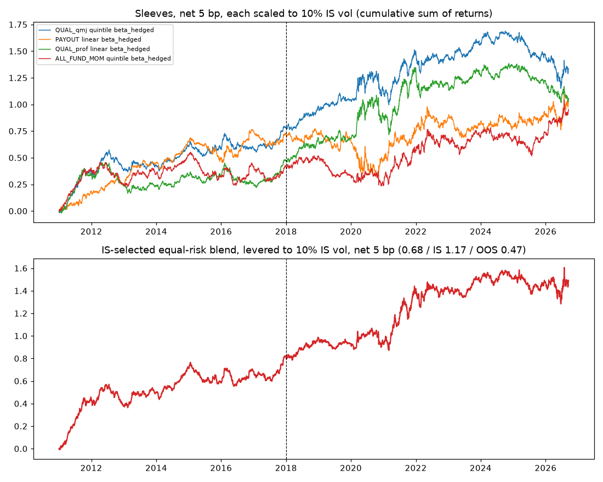

# quality-value-composite — point-in-time fundamental factors from SEC XBRL in S&P 500 names

**Status: Failed** as a standalone strategy; used as a sleeve in `large-cap-sleeve-blend`
(Working). The best honest construction selects sleeves on in-sample Sharpe only and blends
them at equal risk. It earns net Sharpe **0.68 full / 1.17 IS / 0.47 OOS** at 5 bp per side.
Native vol is 2.6 %, so it needs ~5× leverage (gross ≈ 4.5) to reach 10–14 % vol. Sharpe
fell by more than half out of sample, and 2019 and 2025 were negative. Value is dead in this
universe. Profitability survives only once its short-beta tilt is hedged. The sleeve is
almost uncorrelated with residual momentum (ρ −0.01) and the event sleeve, which is why it
earns its place in the blend.

Date: 2026-09-27 · Asset class: us-large-cap · IS 2011-01 → 2017-12 / OOS 2018-01 → 2026-09
(the same split as the earlier us-large-cap cycles; fundamentals start in 2010-Q3 because TTM
needs a prior-year YTD) · 5 bp per side · ~100 books evaluated (36 single-signal, 40
composite, 18 beta-hedged singles, 1 blend + 4 industry-neutral re-runs + cost sensitivity).

Code: `code/us-large-cap/quality-value-composite/` (`signals.py`, `common.py`, `screen1.py` …
`screen4_diag.py`, `figures.py`, **`strategy.py`** → `qvc_weights`; result CSVs next to them).
New shared data layer: `code/us-large-cap/shared/fetch_xbrl.py`, `xbrl.py`,
`fetch_actions.py` → `data/SP500_xbrl_facts.parquet`, `data/SP500_actions.parquet`
(see §2 and `code/shared/DATA.md` §5).

## 1. Idea

The two earlier us-large-cap cycles (`industry-residual-reversal`, `earnings-event-drift`)
both died on the same thing: a 5–20 bp per-trade edge against a 10 bp round trip. Their
conclusion was that a viable signal here needs **quarterly-scale turnover** and a larger
per-trade edge. Fundamental anomalies are exactly that. They cover quality and profitability
(Novy-Marx 2013 gross profitability; Asness-Frazzini-Pedersen *Quality Minus Junk*),
investment (Cooper-Gulen-Schill asset growth; Hou-Xue-Zhang), accruals (Sloan 1996), net
issuance (Pontiff-Woodgate) and value (E/P, CF/P, B/M, S/P). They rebalance monthly and turn
over 1–4× a year. The open question was whether any of it still pays in S&P 500 names after
2010, net of cost, using fundamentals that were **actually public** on the trade date.

## 2. Data: point-in-time fundamentals from EDGAR (new, reusable)

* `fetch_xbrl.py` pulls SEC `companyfacts` JSON for 625 of the 646 priced panel tickers
  (3.29 M facts, 55 us-gaap/dei concepts). CIKs come from Wikipedia for current members and
  from SEC `company_tickers.json` for past members. `--refresh` re-downloads for live use.
* **Recycled tickers**: SEC maps 16 past-member tickers to a *different, later* registrant
  (APC→ARKO Petroleum, BBT→Beacon Financial, STI→Solidion, SE→Sea Ltd, S→SentinelOne …).
  They are dropped in `xbrl.RECYCLED`, and PARA is pinned to Paramount's CIK.
* **Holding-company reorganisations**: the current CIK of XOM (2026), GOOGL (2015), DIS
  (2019), BLK (2024), AVGO, MDT, CI, ICE, ETN, APA … starts at the reorg. `PREDECESSORS`
  attaches the old registrant's filings under the same ticker. Without it, XOM has no
  fundamentals before Aug-2026.
* PIT rules (`xbrl.py`). Every one was tested by truncation: inputs cut at date d reproduce
  the full-sample weights on d to < 1e-6 (`large-cap-sleeve-blend/lookahead_check.py`).
  1. Use only the first-filed value of each (concept, period).
  2. A value is usable at the close of the first session after its EDGAR filing date.
  3. **Alternative tags are merged in filing order.** A lower-priority tag is used until the
     preferred tag is filed, and is never shadowed by it in hindsight.
  4. TTM = FY value, or FY_prev + YTD − YTD_prior. The components must have been filed no
     later than the YTD row, and "nearest period" joins (TTM, year-ago values) only consider
     rows already filed (`_nearest_pit`).
  5. The first version of this reader broke rules 3 and 4 in rare cases. The truncation
     test caught it, and all numbers here are from the corrected reader (they fell by
     ~0.07).
  6. Shares = latest-quarter weighted diluted shares, split-adjusted with the split history
     after the filing date.
  7. Market cap uses the close with the cache's dividend adjustment undone. The live cache is
     re-downloaded with `auto_adjust` on every refresh (`live_lib.daily`), so the reconstruction
     is consistent live as long as `fetch_actions.py` is refreshed too.
* Sanity: 2015-06-30 market caps AAPL $732 B, XOM $350 B, JPM $255 B, BRK $335 B, GOOGL $372 B.
  BRK reports Class-A-equivalent shares (`SHARE_MULT`).
* Coverage of the PIT member universe is 86–90 % in 2011, 95–97 % in 2015 and 99 % in 2025.
  Gross profit and leverage are thinner (55–73 %) because banks and insurers do not report
  them.
* Survivorship: prices exist only for names yfinance still serves (DATA.md §5). Both legs are
  affected, and the books are sector-neutral.

## 3. Method

The signal is a winsorised (±3σ) cross-sectional z-score, demeaned within GICS sector
(Wikipedia for current names, yfinance `.info` mapped to GICS for past names). Books rebalance
on the last trading day of each month and hold constant weights until the next rebalance.
They are dollar-neutral, either quintile L/S (equal weight, gross 1.0) or linear in the
z-score. Weights at close *t* earn t+1, and cost is charged on Σ|Δw|. The **beta-hedged**
variant offsets each book's ex-ante 252-day beta to the EW member market with the EW member
basket, re-sized daily, and the hedge's turnover is charged.

## 4. Results

### 4.1 Single signals (`screen1.py`, net 5 bp)

| signal | book | full | IS | OOS | IC (21d) | IC t |
|---|---|---|---|---|---|---|
| sales/price | linear | **0.39** | 0.37 | 0.41 | 0.004 | 0.4 |
| accruals (−(NI−CFO)/A) | linear | 0.33 | 0.55 | 0.19 | 0.004 | 0.9 |
| shareholder yield (div+buyback)/mcap | linear | 0.31 | 0.54 | 0.23 | **0.015** | **1.8** |
| ROE | linear | 0.21 | 0.31 | 0.15 | 0.007 | 0.9 |
| CFO/assets | quintile | 0.07 | 0.14 | 0.04 | 0.006 | 0.7 |
| gross profit/assets | quintile | −0.06 | 0.03 | −0.11 | 0.008 | 1.1 |
| asset growth (low) / net issuance (low) | quintile | −0.05 / −0.17 | | | | |
| E/P, CF/P, B/M, FCF/P | | −0.32 … 0.11 | | | ≤ 0.005 | |
| low leverage | quintile | **−0.53** | −0.87 | −0.35 | −0.015 | −2.3 |
| 12-1 momentum | quintile | 0.05 | 0.12 | 0.02 | | |
| low vol (dollar-neutral) | quintile | −0.23 | 0.06 | −0.38 | | |

No single fundamental reaches IC t = 2, and the books run at 3–5 % vol.

### 4.2 Composites (`screen2.py`, composites fixed from the literature before running)

| composite | best variant | full | IS | OOS |
|---|---|---|---|---|
| QUAL_qmj (profitability + safety + payout) | quintile, beta-hedged | 0.57 | **1.13** | 0.35 |
| QUAL_prof (GP/A, ROA, ROE, CFO/A, accruals) | quintile, beta-hedged | 0.50 | 0.64 | 0.45 |
| INVEST (asset growth, issuance, accruals) | quintile, raw | 0.46 | 0.43 | **0.49** |
| PAYOUT (shareholder yield, issuance) | linear, beta-hedged | 0.40 | 1.04 | 0.18 |
| ALL_FUND + momentum | quintile, beta-hedged | 0.45 | 0.60 | 0.39 |
| VALUE (E/P, CF/P, B/M, S/P, FCF/P) | quintile, raw | 0.11 | 0.03 | 0.15 |
| QV, ALL_FUND | | ≤ 0.26 | | |

Quality composites are flat unhedged and positive beta-hedged. Quality names are low-beta, so
a dollar-neutral quality book is short the market.

### 4.3 What the beta hedge does (`screen4_diag.py`)

Beta-hedged singles: CFO/A **0.47** (IS 0.69 / OOS 0.40), ROE 0.33 (0.35 / 0.33), ROA 0.27,
accruals 0.24. Hedging does nothing for value (B/M goes to −0.39). Low-vol beta-hedged, i.e.
BAB, is 0.39 but decays from IS 1.09 to OOS 0.10. The durable part is **cash-based
profitability at constant beta**, at about 0.3–0.5 Sharpe.

### 4.4 IS-selected blend (`screen3_blend.py`, packaged in `strategy.py`)

Protocol, fixed before OOS was read: keep the best-IS variant of every composite with IS Sharpe
≥ 0.5, and weight them by inverse IS vol. That gives four sleeves: QUAL_qmj quintile-β 0.212,
PAYOUT linear-β 0.258, QUAL_prof linear-β 0.265, ALL_FUND_MOM quintile-β 0.265.

| | full | IS | OOS | CAGR (10 % IS-vol) | max DD | turnover/yr | avg gross |
|---|---|---|---|---|---|---|---|
| blend, 5 bp | **0.68** | 1.17 | **0.47** | 8.9 % | −27.5 % | 12.1 (levered) | 4.5 |
| blend, 2 bp | 0.71 | 1.21 | 0.49 | | | | |
| blend, 10 bp | 0.64 | 1.11 | 0.44 | | | | |

Yearly Sharpe: 2011 3.9, 2012 −0.6, 2013 1.3, 2014 2.7, 2015 −1.4, 2016 1.0, 2017 1.5 |
2018 1.8, 2019 −0.8, 2020 0.0, 2021 2.3, 2022 0.0, 2023 0.6, 2024 0.3, 2025 −0.2, 2026 0.1.
Correlation to residual momentum is −0.01. The result is signal-bound, not cost-bound: it
still earns 0.44 OOS at 10 bp. Industry-neutral (GICS sub-industry) versions are worse (≈3
names per industry), except PAYOUT at 0.65.

## 5. Why Failed (standalone)

* OOS 0.47 is the honest number after IS selection. IS→OOS decay is 60 %, and 2024–26 are
  close to zero.
* Native vol is 2.6 %, so a useful return needs gross ≈ 5, and the −28 % levered drawdown
  shows the left tail of levered factor books (2012, 2015, 2019).
* Multiple testing: about 100 books. The best-of-40 composite IS Sharpe of 1.13 is inflated,
  so only the OOS column counts.

## 6. What is reusable

* The PIT fundamentals layer (`xbrl.py`) is correct, truncation-tested and fast (~30 s for
  16 panels × 16 years). Use it for any fundamental idea in this asset class.
* `qvc_weights` is the market-uncorrelated quality sleeve used in `large-cap-sleeve-blend`.
* Not tried: analyst revisions (no free data), fundamental momentum/SUE, sector-timing of
  quality.
