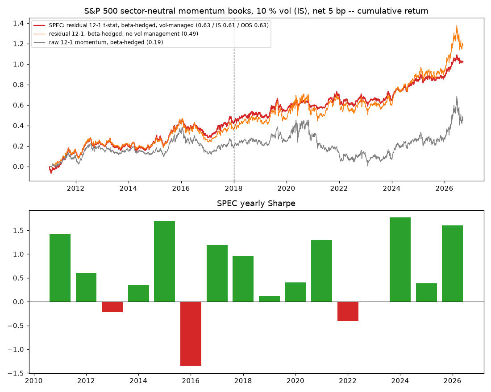

# residual-momentum — market- and sector-residual 12-1 momentum in S&P 500 names

**Status: Working (modest).** The spec is fixed from the literature: a residual-return t-stat
over 12-1 months, sector-neutral linear L/S, monthly, beta-hedged, vol-managed. It earns net
Sharpe **0.63 full / 0.61 IS / 0.63 OOS** at 5 bp per side and 10 % vol, with no decay
between the halves. Raw 12-1 momentum in the same book earns 0.19. It is uncorrelated with
the market (ρ 0.13 to SPY) and with the fundamental sleeve from `quality-value-composite`
(ρ −0.01). It is one of the four sleeves of `large-cap-sleeve-blend` (1.03 / 1.57 / 0.81 OOS),
which is the recommended deploy; see §6.

Date: 2026-09-27 · Asset class: us-large-cap · IS 2011-01 → 2017-12 / OOS 2018-01 → 2026-09
(split fixed in advance, same as the other us-large-cap cycles) · 5 bp per side, charged on
every weight change including the hedge and the vol-scaling · ~75 books evaluated.

Code: `code/us-large-cap/residual-momentum/` — `screen1.py` (13 signals × 4 books),
`screen2.py` (holding / vol management), `screen3_robust.py` (spec + neighbourhood),
`lookahead_check.py`, **`strategy.py`** (`residual_momentum_weights`), `figures.py`.
Spec: `alphas/us-large-cap/residual-momentum/spec.md`.

## 1. Idea

Price momentum in US large caps has been close to dead since 2009. In the fundamental screen
of `quality-value-composite`, 12-1 momentum was 0.05 net, and 0.19 beta-hedged. Much of
conventional momentum's risk is a *time-varying factor bet*: after a rally the winners are
high-beta names in the winning sectors, and the book crashes when those factors reverse
(Daniel-Moskowitz 2016). Blitz, Huij & Martens (2011, *Residual momentum*, JEF) and Gutierrez
& Pirinsky (2007) rank stocks on the **idiosyncratic** part of their return, scaled by
idiosyncratic vol. They report roughly double the Sharpe and none of the crash exposure. The
under-reaction story (firm-specific news diffuses slowly) is the part of momentum that
should survive in large caps. Industry momentum is a different, noisier effect, and the
sector-ETF research found it dead.

## 2. Construction (`strategy.py`)

1. **Factors**: the EW daily return of PIT S&P 500 members (M), and the EW return of members
   in the stock's GICS sector (S).
2. **Betas**: rolling 252-bar OLS of each stock's daily return on (M, S), as of t.
3. **Score**: the residual e = r − bM·M − bS·S, summed over bars [t−251, t−21] and divided by
   its std·√n. This is a residual t-stat, and the last month is skipped (short-term reversal).
4. **Book**: winsorised (±3σ) z-score, demeaned within sector. Weights are linear in the
   z-score and dollar-neutral with Σ|w| = 1. They are set at the close of the last NYSE
   session of each month (`trading_calendar.month_end_sessions`) and held.
5. **Beta hedge**: the book's ex-ante 252-bar beta to M is offset with the EW member basket
   (or RSP), re-set monthly.
6. **Vol management** (Barroso & Santa-Clara 2015): the whole book is scaled by
   10 % / realised vol of its own unscaled daily returns over 126 bars, capped at 3.6×, and
   re-set monthly. Average gross is 2.36, max 3.55.

Weights at close t earn t→t+1 (the `xs_lib` convention). The live book fills at the close
the signal was computed on.

## 3. Results

### 3.1 Signal screen (`screen1.py`, sector-neutral monthly books, net 5 bp, unscaled)

| signal | quintile | quintile β-hedged | linear | linear β-hedged (IS / OOS) |
|---|---|---|---|---|
| raw 12-1 | 0.04 | 0.16 | 0.08 | 0.19 (0.28 / 0.17) |
| **residual (M+S) 12-1 t-stat** | 0.25 | 0.47 | 0.26 | **0.49 (0.53 / 0.50)** |
| residual (M+S) 12-1 raw sum | 0.23 | 0.43 | 0.26 | 0.45 |
| residual (market only) 12-1 t-stat | 0.19 | 0.42 | 0.22 | 0.44 |
| residual 6-1 t-stat | 0.13 | 0.28 | 0.18 | 0.36 |
| residual, 504-bar betas | 0.13 | 0.33 | 0.17 | 0.35 |
| 52-week-high proximity (George-Hwang) | −0.14 | 0.09 | −0.08 | 0.18 (0.41 / 0.08) |
| frog-in-the-pan momentum (Da-Gurun-Warachka) | 0.00 | 0.07 | 0.03 | 0.14 |
| residual × continuous information | 0.18 | 0.41 | 0.16 | 0.41 (0.66 / 0.31) |

Residualising on market + sector lifts the net Sharpe from ≈0.1 to ≈0.25. The beta hedge
adds another 0.2: sector-neutral residual winners still carry a small negative beta. The
52-week-high anchor and frog-in-the-pan filter add nothing post-2011.

### 3.2 Holding and risk management (`screen2.py`)

| linear β-hedged | full | IS | OOS | vol |
|---|---|---|---|---|
| monthly | 0.49 | 0.53 | 0.50 | 5.5 % |
| monthly, **vol-managed** | **0.66** | 0.67 | 0.66 | 3.7 % |
| 3-month tranches | 0.47 | 0.43 | 0.52 | 5.1 % |
| 3-month tranches, vol-managed | 0.66 | 0.62 | 0.69 | 3.4 % |

Vol management adds +0.17 to +0.19 in every configuration and in both halves. Tranching
cuts turnover by 45 % at no Sharpe cost, so a slower live book is an option.

### 3.3 Spec through `strategy.py` (`screen3_robust.py`, 10 % vol)

| config | full | IS | OOS | CAGR | max DD | turnover/yr | avg gross |
|---|---|---|---|---|---|---|---|
| **SPEC** | **0.63** | 0.61 | **0.63** | 6.3 % | −16.9 % | 12.7 | 2.36 |
| est window 189 / 378 | 0.59 / 0.58 | | | | | | |
| formation 189 / 315 | 0.54 / 0.60 | | | | | | |
| skip 10 / 42 | 0.59 / 0.63 | | | | | | |
| quintile book | 0.63 | 0.65 | 0.61 | | | | |
| hedge with RSP instead of EW basket | 0.60 | 0.59 | 0.62 | | | | 2.55 |
| no vol management | 0.46 | 0.49 | 0.48 | | | 5.3 | 1.00 |
| no beta hedge | 0.42 | 0.35 | 0.47 | | | | |
| cost 2 bp / 10 bp | 0.66 / 0.57 | | | | | | |

Neighbourhood range 0.54–0.63. No parameter was chosen on these numbers: the spec is the
BHM default (252/252/21) with the two overlays decided in screen 2. Yearly Sharpe:
2011 1.4, 2012 0.6, 2013 −0.2, 2014 0.3, 2015 1.7, **2016 −1.3**, 2017 1.2 | 2018 1.0,
2019 0.1, 2020 0.4, 2021 1.3, 2022 −0.4, 2023 0.0, 2024 1.8, 2025 0.4, 2026 1.6. Correlation
to SPY is 0.13. The long residual winners earn +18.6 %/yr gross and the short losers cost
−11.3 %/yr: both legs contribute alpha relative to the hedge.

### 3.4 Lookahead and live-consistency (`lookahead_check.py`)

The inputs were truncated at five dates (three mid-month, two month-end) and the weights
recomputed. The weights on the truncation date equal the full-sample weights exactly
(max |Δw| = 0.0) at all five dates. A partially observed month never triggers a rebalance.

## 4. Caveats

* **Survivorship**: yfinance serves no delisted tickers, so short-leg losers that were
  acquired or went bankrupt after leaving the index are missing (DATA.md §5). Membership
  itself is point-in-time. The bias is mostly acquisitions, which would *hurt* a short-loser
  leg, so it is probably small and could go either way.
* **Sectors are today's GICS** (static). GOOGL/META/NFLX moved to Communication Services in
  2018, so sector-neutrality before 2018 is slightly off.
* **Multiple testing**: ~75 books. Deflated Sharpe (Bailey-López de Prado) of the spec is
  0.81 at 10 effective trials and 0.52 at 70 independent trials. The trials are highly
  correlated (one signal family), so the truth is nearer the first number. A 0.6 Sharpe on
  15.7 years is t ≈ 2.4, meaningful but not overwhelming.
* 2016 (−1.3) was the quality/value rotation after the US election. Momentum's known crash
  regime is not fully removed by the beta hedge.

## 5. Deployment notes

* Universe: current S&P 500 constituents, all in the flat daily cache. Live `member` can be
  "current constituent and priced"; the PIT membership file only matters for history.
* Needs ~275 bars of history per name (252 formation + 21 skip).
* Hedge: the EW member basket (as backtested) or RSP (0.60 vs 0.63, one line instead of 500).
* Leverage: average gross 2.4, maximum 3.6, by construction of the vol scaling.

## 6. Blend note

Residual momentum correlates −0.01 daily with the `quality-value-composite` IS-selected
fundamental blend (OOS −0.05), −0.09 with the index-reconstitution event sleeve, and 0.23 with
the filing-text sleeve. An equal-risk RM + QVC pair (weights from IS vol) gives 0.82 / 1.12 /
0.70 OOS. The four-sleeve book in `large-cap-sleeve-blend` gives **1.03 / 1.57 / 0.81 OOS**
at 5 bp. Standalone, this sleeve is the only one that needs nothing but prices, so it is the
simplest thing to deploy if the EDGAR pipelines cannot run live.
